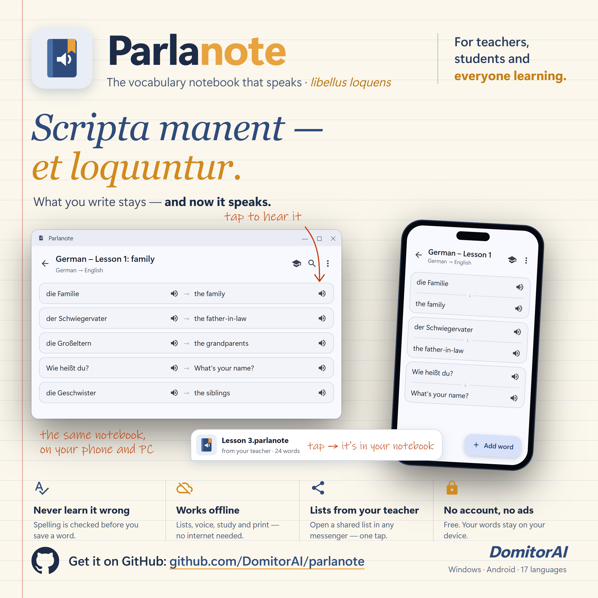
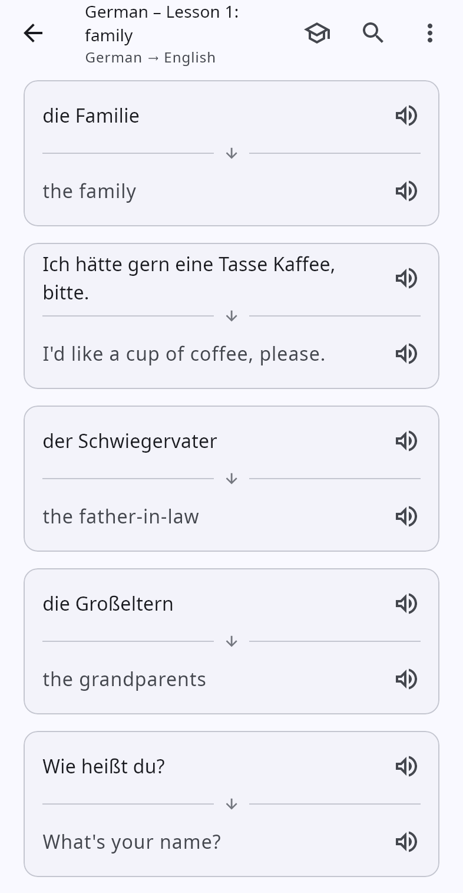
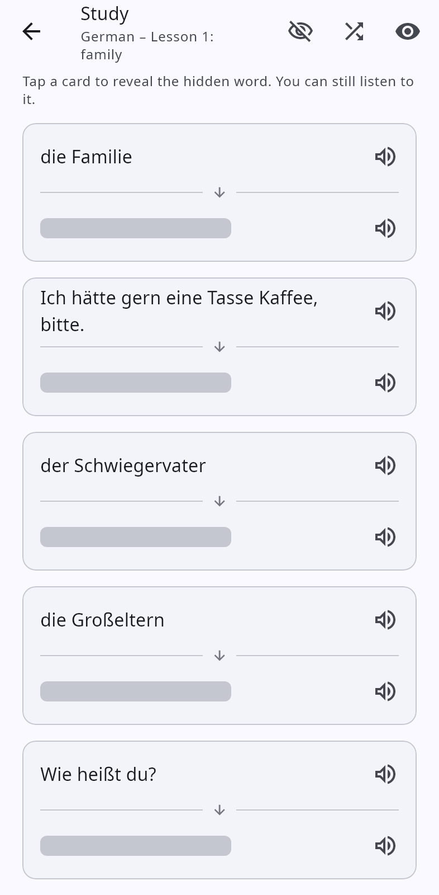
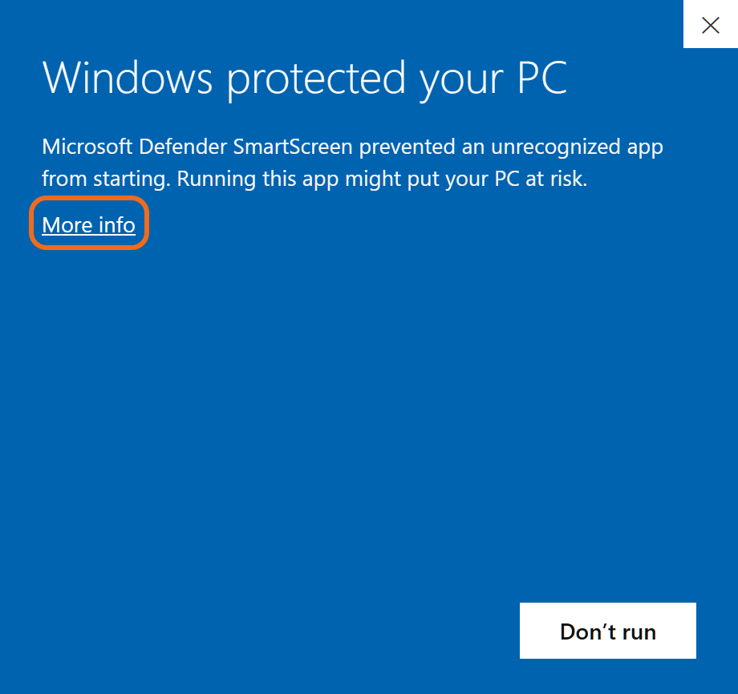
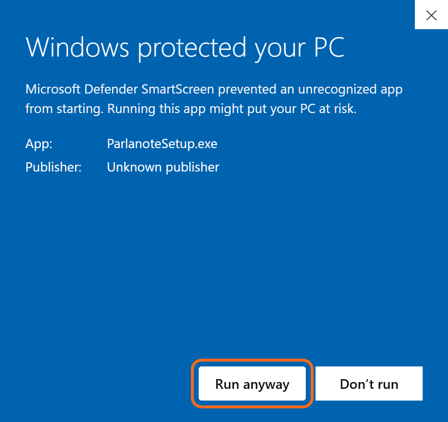
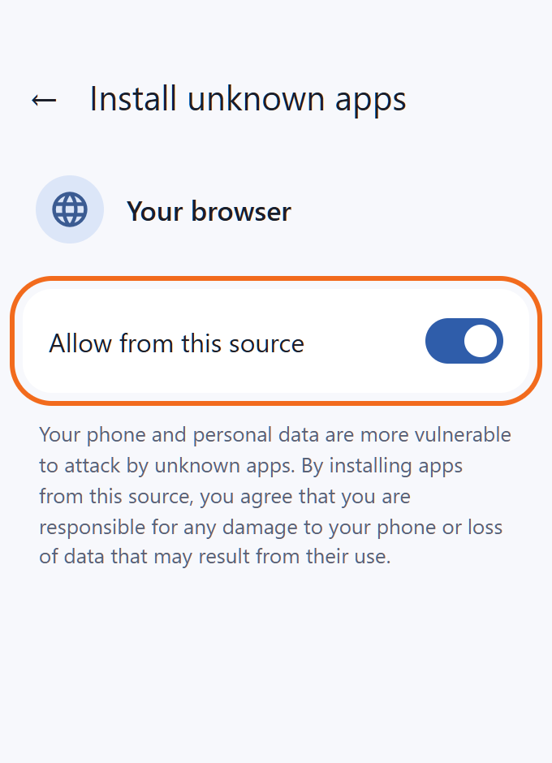

<p align="center">
  <a href="assets/banner.png"></a>
</p>

<h1 align="center">Parlanote</h1>

<h2 align="center">YOUR VOCABULARY NOTEBOOK<br>THAT SPEAKS</h2>

<p align="center">
  <b>Learning a language?</b> Write down a new word or phrase — Parlanote checks the spelling, fills in the
  translation and says it out loud. Your notebooks are on your phone and on your PC, even without internet.
</p>

<p align="center">
  <b>Teaching one?</b> Send today's words to your class in any messenger. One tap, and the list is in every
  student's notebook — with translation and pronunciation. No accounts, no school platform.
</p>

<p align="center">
  <b>Free.</b> · No account. · No ads. · Works offline. · Windows and Android. · 17 languages.
</p>

## 1. Overview

**Parlanote is a notebook for the words and phrases you learn: you write them, you hear them, you review them.**

A paper vocabulary notebook can't tell you how a word sounds, or whether you spelled it right — and it is hard to
share with a class. Translation apps translate, but they are not made for keeping your own list.
Parlanote is the notebook: simple to use, and it speaks.

*Scripta manent — et loquuntur:* what you write stays — and speaks.

### Why use it

- **Hear every word.** A 🔊 button next to each word and its translation, with your device's own voice.
- **Never learn it wrong.** A typo is shown with the right spelling before you save the word.
- **The translation fills itself in.** Type the word — the translation appears. You can always change it.
- **Works offline.** Your notebooks, the voice, studying and printing work without internet. What you write
  offline is checked as soon as you are back online.
- **Phone and PC.** The same notebooks on Android and Windows. Move them with one file — nothing is lost on either side.
- **Lists from your teacher or a friend.** Open a shared list from any messenger: the new words are added, yours stay.
- **Test yourself.** Hide one column, remember the word, tap the card to check.
- **Print.** The list for your paper notebook, or a practice sheet with one column left empty.
- **Private.** No account, no ads, no data collection. Your words stay on your device.

### For whom

| You are… | Parlanote helps you… |
|---|---|
| a **student** | keep the words of each lesson, listen to them on the bus, test yourself before class |
| a **teacher** | send the word list to the whole class in the messenger you already use |
| **learning on your own** | write down words from books and films — spelled right, with pronunciation |
| **travelling or moving abroad** | keep the phrases you need, with sound, even with no internet |

### Features

- Separate notebooks for lessons, topics or trips, each with two languages (for example German → English).
- 17 languages: English, German, French, Spanish, Italian, Portuguese, Dutch, Romanian, Russian, Ukrainian,
  Polish, Turkish, Czech, Swedish, Greek, Japanese and Chinese.
- The app itself speaks English, Romanian, German, Italian, Polish, Russian and Ukrainian.
- Sort alphabetically (*der*, *die*, *das* and other articles don't get in the way) or by date; swap the columns;
  search without accents.
- Study mode: hide one column, shuffle, reveal one card or all.
- Back up or move everything to another device with one file; share a single list with anyone.
- Print or save as PDF.

<p align="center">
  
  &nbsp;&nbsp;
  
</p>

## 2. Requirements

- **Windows:** Windows 10 or Windows 11 (64-bit).
- **Android:** Android 8.0 or later.

Internet is needed only for the automatic translation and the spell check. Everything else works offline.
The voice comes from your device: see [Voices](#5-voices) if a language stays silent.

## 3. Installation

Download the file for your device from the [latest release](https://github.com/DomitorAI/parlanote/releases/latest):

| Device | File |
|---|---|
| Windows PC | **ParlanoteSetup.exe** |
| Android phone or tablet | **Parlanote.apk** |

### Windows

1. Download **ParlanoteSetup.exe** and double-click it (in your **Downloads** folder).
2. Windows may show a blue **Windows protected your PC** window, because Parlanote is new and not yet known
   to Microsoft Defender SmartScreen. Press **More info**:

<p align="center">
  
</p>

3. Press **Run anyway**:

<p align="center">
  
</p>

4. Choose **Install for me only** (no administrator rights needed) or for all users, then follow the steps.

**You should see:** Parlanote in the **Start** menu (and on the Desktop, if you chose it). Double-clicking a
`.parlanote` file opens it in Parlanote.

**Word lists sent from a phone** are named `….parlanote.json`. The first time you double-click one, Windows asks
which app to use: choose **Parlanote** and **Always**. Your other JSON files are not affected: Parlanote looks
inside the file and sends any JSON that is not a word list straight to the app you choose once (Notepad, VS
Code, your browser…). You can change that app in Parlanote: **Settings → JSON files**.

**Your browser warns about the download?** Some browsers warn about any `.exe` file they cannot scan.
Choose **Keep** / **Download anyway**.

### Android

1. On the phone, open the [latest release](https://github.com/DomitorAI/parlanote/releases/latest) and tap
   **Parlanote.apk**. If the browser asks whether to keep the file, choose **Download anyway**.
2. Open the downloaded file (from the notification or the **Downloads** folder).
3. The first time, Android asks for permission to install apps from your browser: tap **Settings**, turn on
   **Allow from this source**, and go back.

<p align="center">
  
</p>

4. Tap **Install**.
5. Google Play Protect may say the app is unknown. Tap **More details** → **Install anyway**.

**You should see:** the Parlanote icon among your apps. A `.parlanote` file received in a messenger opens in Parlanote.

### If your antivirus warns about Parlanote

Parlanote is new, so some antivirus programs don't know it yet. They may warn or block the file — not because they
found anything harmful, but because few people have downloaded it so far.

- **On your own device:** check that the file comes from this page (see [Check the file](#check-the-file-optional)),
  then choose **Allow** / **Restore** in your antivirus.
- **On a work or school PC:** the antivirus is managed by your IT department. Ask them to allow Parlanote.

### Check the file (optional)

Every release lists the SHA-256 checksum of each file (files `ParlanoteSetup.exe.sha256` and
`Parlanote.apk.sha256`). On Windows, to compare:

```bat
certutil -hashfile "%USERPROFILE%\Downloads\ParlanoteSetup.exe" SHA256
```

### Coming soon

**Microsoft Store** and **Google Play**. They will be added here once they are available.

## 4. Using Parlanote

1. **Create a notebook:** tap **New notebook**, give it a name (for example *German – Lesson 1*) and choose the
   language you learn and the translation language.
2. **Add words:** tap **Add word** and type a word or a phrase. The translation is filled in for you; a
   misspelled word is underlined with suggestions. Press **Save**.
3. **Listen:** tap 🔊 next to any word or translation.
4. **Study:** tap the 🎓 button. One column is hidden — say the word, then tap the card to check.
   Choose which column to hide, or **Shuffle** the cards.
5. **Print:** in the notebook's ⋮ menu, choose **Print / Save PDF…**. Tick **Leave the … column empty** for a
   practice sheet.

**Offline?** Write as usual — if your device has a spell checker for the language, mistakes are still
underlined. Words waiting for the translation or the online check are marked ⏳; tap **Verify now** when you are
back online.

**A word marked ⚠?** Tap it: Parlanote shows the suggested spelling — one tap corrects it, or choose
**Keep as is**.

**Many words at once:** hold a word (right-click on Windows) → **Select**, tick the others or **Select all**,
then delete them, move or copy them to another notebook with the same languages, or check them again.

## 5. Voices

Parlanote speaks with the voices installed on your device, so pronunciation works offline too. If a language stays
silent, Parlanote tells you and offers **How to install** — the steps and a button that opens the voice settings.

- **Windows:** **Settings → Time & language → Speech → Manage voices → Add voices**. If the new voice does not
  appear, restart the PC, or add the language in **Settings → Time & language → Language & region** (with
  *Text-to-speech*). On a work PC, adding voices may be blocked — ask your IT department.
- **Android:** **Settings → System → Languages → Text-to-speech output → Preferred engine settings →
  Install voice data** (the names differ a little between phone brands).

The speed of the voice is in Parlanote's **Settings**.

## 6. Move notebooks and share lists

**Your own devices** — from the main menu ⋮ choose **Back up / move to another device…** and save the file.
Open it on the other device (send it to yourself, or copy it). Parlanote shows what is new, what is already there
and what to decide; nothing is lost on either side, and when the same word was changed on both devices you choose
which version to keep.

**A list for others** — in a notebook's ⋮ menu choose **Share list…**, add a title and (optionally) your name
and a description, and send the file in any messenger or by e-mail. Whoever opens it gets the new words added to
their notebooks — nothing of theirs is overwritten or deleted.

## 7. Settings

| Setting | What it does |
|---|---|
| **Language** | The language of the app. By default it follows your device. |
| **Your e-mail for MyMemory** (optional) | The free translation service allows 5,000 characters a day; with an e-mail, 50,000. The e-mail is sent only to MyMemory. Today's use is shown below. |
| **Check spelling online** (default: on) | New words are sent to LanguageTool for spelling suggestions. Turn it off and nothing is sent — your device's own spell checker still underlines mistakes, if it knows the language. |
| **Voice** | Slow, normal or fast; **Listen** to try it. If your device has several voices for a language of your notebooks, choose the one you like under **Voice for each language**. |
| **Check for new versions once a day** (default: on) | Parlanote asks GitHub whether a new version exists and offers to update with one tap (see [Updates](#10-updates)). Turn it off if you prefer, or if your school or company does not allow it. |

## 8. Privacy and security

Full text: [privacy policy](PRIVACY.md).

- **No account, no ads, no data collection.** Parlanote has no server of its own and collects no usage data.
- **Your notebooks stay on your device.** They leave it only when you export or share a file yourself.
- **Two online services, only for the word you are writing:** the word or phrase and its languages go to
  **MyMemory** (translation suggestions) and **LanguageTool** (spell check), and only while you are online.
  The spell check can be turned off in **Settings**.
- **Once a day, the version number:** Parlanote asks GitHub (`api.github.com`) for the number of the latest
  version — the request carries no information about you. It downloads nothing by itself: only when you press
  **Update** does it download the new version from this page's releases, and it checks the file before
  installing it. You can turn the daily check off in **Settings**.
- **No other connections.**

## 9. FAQ and Troubleshooting

**The 🔊 button is silent.**
No voice is installed for that language — see [Voices](#5-voices). Also check that the device's volume is up.

**"Daily translation limit reached".**
The free translation service has a daily limit. Write the translation yourself, try again tomorrow, or add your
e-mail in **Settings** for a 10× higher limit.

**A word stays marked ⏳.**
It is waiting for the translation or the spell check. Connect to the internet and tap **Verify now**.

**The translation is wrong.**
It is a suggestion from an online service, not a dictionary. Tap the word and correct it — your version is kept.

**Android says "App not installed" or "package conflicts with an existing package".**
There is not enough free space, or an older Parlanote from another source is installed — sometimes in another
user of the phone (for example **Guest**), where you don't see it. Back up your notebooks first (see
[Move notebooks](#6-move-notebooks-and-share-lists)), uninstall Parlanote — also in the other users of the phone,
if there are any — and install it again.

**Windows says the app "has been blocked by your system administrator".**
Your organization allows only approved programs. Ask your IT department.

**Android says it cannot install the update.**
Turn on **Allow from this source** for Parlanote (**Settings → Apps → Special access → Install unknown apps** —
the names differ a little between phone brands), then press **Update** again.

**A shared list does not open from the messenger.**
Save the file, then open Parlanote and choose **Import…** from the main menu ⋮.

## 10. Updates

When a new version is out, Parlanote tells you: **Parlanote X is available** with an **Update** button (it
checks once a day; you can turn this off in **Settings**). Press **Update** — Parlanote does the rest:

- **Windows:** it downloads the new version, checks it, closes, installs it and opens again by itself.
  If Parlanote was installed for all users, Windows asks once for permission (**Yes**).
- **Android:** it downloads the new version and checks it; Android then asks you to confirm — tap **Update**.
  The first time, Android asks for permission to install updates from Parlanote: turn on
  **Allow from this source** and go back — the update continues.

When Parlanote opens again, it says **Parlanote updated to X**. **Your notebooks and settings are kept.**

**The update did not work?** Check your internet connection and press **Try again**, or choose
**Open download page** and install the new file over the old one, as in [Installation](#3-installation).

## 11. Uninstall

**Windows:** **Settings → Apps → Installed apps → Parlanote → Uninstall**. The uninstaller asks whether to delete
your notebooks too — the default is **No**, so they are still there if you install Parlanote again.

**What is removed:** the program, its shortcuts, the `.parlanote` file association and the entry in **Installed apps**
(and your notebooks and settings, if you answer **Yes**).

**Android:** hold the Parlanote icon → **Uninstall**. Android always deletes the app's data with it, so
**back up your notebooks first** (**Back up / move to another device…**).

## 12. Feedback

Parlanote grows from what its users need. Tell us what to improve — also straight from the app:
**Settings → About Parlanote → Suggest a feature or a wish / Report a problem**.

- [Suggest a feature or tell us what you wish for](https://github.com/DomitorAI/parlanote/issues/new?template=feature_request.yml)
- [Report a bug](https://github.com/DomitorAI/parlanote/issues/new?template=bug_report.yml)
- [Questions and ideas](https://github.com/DomitorAI/parlanote/discussions) — also for teachers who want to share how they use it.
- **Security vulnerability:** [report it privately](https://github.com/DomitorAI/parlanote/security/advisories/new) — never in a public issue ([SECURITY.md](SECURITY.md)).
- Liked it? A ⭐ on the repository helps others find it.

## 13. License

- Free to use without limits: at home, at school, at work, on any number of devices.
- You may share the unmodified installer and app free of charge — for example with your class.
- Selling Parlanote, or presenting it — or a modified version — as your own work, needs the author's permission.
- Provided as is, without warranty.

See [LICENSE](LICENSE).

Do you need a permission the license does not cover, or a version made for your school or organization?
[Open a **Contact request**](https://github.com/DomitorAI/parlanote/issues/new?template=contact_request.yml).
Don't write confidential details there, because issues are public. You will get a reply on how to continue privately.

## 14. About

Made by [**DomitorAI**](https://github.com/DomitorAI) — Svatantra Dev (स्वतन्त्र).

Translation suggestions by [MyMemory](https://mymemory.translated.net), spell check by
[LanguageTool](https://languagetool.org).
